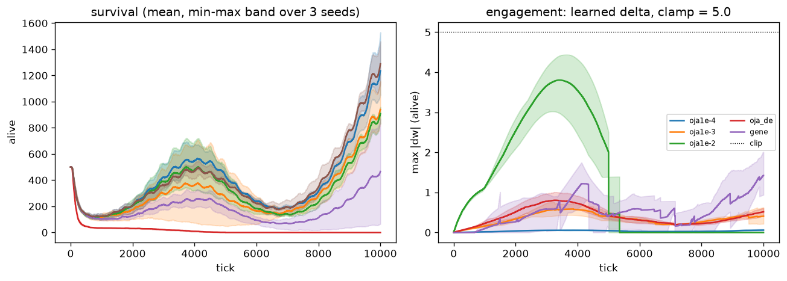

# Primordia

[](LICENSE)
[](pyproject.toml)
[](tests/)


**A 2D ecosystem where neural creatures evolve by natural selection — there is
no fitness function anywhere.** Creatures that survive and accumulate energy
split in two; creatures that starve, age out, or get bitten die. Predation,
flocking, and herding are not programmed — either they emerge from selection
on the evolved body/brain traits, or they don't. This repo is an honest
attempt to find out which, with reproducible experiments and published
negative results.

**Leia em português:** [README.pt-BR.md](README.pt-BR.md)

```bash
pip install -e ".[render,dev]"
python run.py --seed 42                # windowed viewer
python run.py --seed 42 --headless --ticks 5000 --stats s42.npz
pytest -q
```

## Contents

- [How it works](#how-it-works)
- [Inspirations](#inspirations)
- [What I discovered](#what-i-discovered)
- [Challenges and open problems](#challenges-and-open-problems)
- [Viewer](#viewer)
- [The world that runs by itself](#the-world-that-runs-by-itself)
- [Performance](#performance)
- [Reproduce everything](#reproduce-everything)
- [Project layout](#project-layout)
- [Roadmap (25 stages)](#roadmap-25-stages)
- [License](#license)

## How it works

- **No fitness, no objectives.** Energy is the only currency: eat food (or
  meat), pay metabolic and movement costs, and split when you cross
  `reproduce_threshold`. Death = energy ≤ 0, `max_age`, or a predator's bite.
  Nothing in the tick ever rewards "intelligence", distance travelled, or any
  particular behaviour.
- **Evolvable body and brain.** Each creature is a genome of **454 values**:
  a **38-input** network (7-ray food sum, creatures, prey and carrion peak
  channels, left/right food antennas, internal state, ambient light, three
  signal-field sensors, the hue similarity of neighbours in the smell window,
  the wood smell of that same window, two bite scars — accumulated stress and
  a recency-faded rancor toward the last attacker's hue — and, since stage 25,
  a signed bank reading: + if you stand on your own banked house, − on a
  foreign one) → **8 hidden units** with Elman recurrence → 8 outputs: turn,
  accelerate, eat/attack/withdraw/raid, emit signal, donate energy, gather
  wood, build a campfire, build a house — plus **6 body traits**: max speed,
  size, vision range, *diet* (0 = herbivore; predation capability is itself a
  trait that has to evolve), a heritable lineage hue — neutral by
  construction, shown as a ring under the sprite — and the learning rate η of
  the plasticity rule. Informational inputs (stress, grudge, the bank) are
  **readings of what the world already holds, never prizes**; the affect
  channel is off by default and the experiment that turned it on halved the
  population (stage 24, below).
- **Sex and aging, not just cloning.** Reproduction is sexual: an initiator
  above the threshold searches for a nearby partner, each parent pays half
  the child's energy, and the genome is a per-gene crossover plus mutation.
  Old bodies wear out (`w = exp(senescence_rate * age)`): metabolism grows
  while speed and vision shrink. No partner → no birth: mobility and
  aggregation get selected without being programmed.
- **A world that pushes back.** Terrain fertility and lakes shape where food
  grows, a sun sets a day/night light cycle (vision shrinks at night), and
  seasons modulate growth — all pure physics from `Config`, no objectives.
  Wood grows in patches; campfires cook; houses can be raised in deliveries,
  shield their owner, and rot if unfinished; deposited energy can be guarded
  or raided; a mark on the ground trims your metabolic bill.
- **Headless core, one-way rendering.** The core modules (`world`, `step`,
  `brain`, `genome`, `sensors`, `stats`, `io`) never import pygame or
  matplotlib; the viewer only reads state.
- **Deterministic.** Same `--seed` ⇒ bit-identical simulation on the same
  machine, including across save/load (`--save`/`--load` restore both RNG
  streams and the genealogy log).
- **Data-oriented.** Fixed-capacity SoA arrays with a free-list — no Python
  objects per creature, no allocation in the tick, spatial-hash neighbor
  queries, everything hot in Numba `@njit`.

## Inspirations

Primordia stands in a lineage of artificial-life projects that ask the same
question — *how much can emerge from very little?*

- **Conway's Game of Life (1970)** — the founding demonstration that fixed,
  dumb, local rules give gliders, guns and computation with nobody in charge.
  Primordia's rule has the same shape: a creature only eats, pays and splits;
  predation, herds and borders are written nowhere.
- **Tierra (Thomas Ray, 1991) and Avida** — free-living digital organisms
  competing and reproducing in code, studied *without* a hand-fed fitness
  function; Avida in particular showed how to *measure* evolution instead of
  prescribing it. That is the method here: run the world, then measure.
- **Polyworld (Larry Sims, 1996)** — a 2D ecosystem where brains and bodies
  are encoded in the genome and drawn as a living map: a direct ancestor of
  Primordia's viewer.
- **NEAT and evolving neural networks (Stanley & Miikkulainen, 2002)** — the
  habit of putting connection weights in the genome and letting selection
  shape behaviour. Primordia keeps a fixed, deliberately small topology (the
  500-parameter budget) instead of evolving structure, so every new sense has
  to earn its way into a tight budget.
- **The Blind Watchmaker (Dawkins, 1986)** — biomorphs showing that selection,
  not design, explains the appearance of purpose. "No fitness, no objectives"
  is that idea taken literally.

What this project adds on top of that old dream is the engineering discipline
around it: bit-exact determinism, versioned saves, pre-registered experiments
with published failures, and a performance floor that runs on a laptop CPU.

## What I discovered

Results accumulated across the experiment suite
([`experiments/`](experiments/)) — stages 8 through 25, mostly 3 seeds ×
5 000–10 000 ticks each. Full method and limitations in each experiment's
README.

> **Reproducibility note.** The tables and figures below were produced on the
> pre-stage-9 tree (19-input, 12-hidden feedforward brains, uniform food
> field, the old food economy). Stage 9 changed the brain layout (28 inputs,
> 10 hidden units, Elman recurrence), stage 9.5 recalibrated the economy,
> stage 10 added a 29th input (ambient light) plus terrain/day-night/seasons,
> stage 11 switched to sexual reproduction, added senescence and carrion
> (30 inputs, `FORMAT_VERSION 4`), stage 12 widened the genealogy log
> with the mating partner and added the species/barrier stats columns
> (`FORMAT_VERSION 5`), stage 13 wired the common signal channel
> (33 inputs, a 4th brain output, `FORMAT_VERSION 6`), stage 14 made
> that channel diffuse — a Jacobi pass spreads the field into trails
> (config-only, `FORMAT_VERSION` stays 6), stage 15 added a neutral
> lineage hue (34 inputs, a 5th body trait, `FORMAT_VERSION 7`), stage
> 16 opened a donation channel (a 5th brain output gifting energy to the
> nearest neighbour, 9 hidden units, `FORMAT_VERSION 8`), stage 17
> added the civilization base (a wood-smell input and three outputs for
> gather/build-fire/build-house, `FORMAT_VERSION 9`), stage 18
> recalibrated the *default* prices only (fire 10 → 5, houses priced
> out of the default world at 1e6 — Config, no tick change), stage 19
> added the SQLite daemon (Config/CLI/storage only), and stage 21 opened
> lifetime Oja plasticity on a separate `dw` scratch (6th body trait η,
> 491 genome params, `FORMAT_VERSION 10` — the effective synapses are
> `genome + dw`, and the genome is never written inside a life). The
> plasticity **default is off**, and with it the tick is bit-identical
> to the pre-stage-21 logic; but the genome grew 490 → 491 (the η trait
> adds one mutation draw at birth), which shifts the shared Numba RNG
> stream — so even `off` reruns on current HEAD may produce different
> trajectories and numbers than stage-19/20 caches. Bit-exact
> reproduction of old figures still needs the old commit. Stages 22–23
> kept the v10 layout (incremental houses and the off-tick group
> observer are Config/scratch changes only); stage 24 bumped the layout
> once more — the affect pair (stress + grudge) appended two inputs
> (37 in), and the budget forced hidden 9 → 8, so the genome *shrank*
> 491 → 446 (`FORMAT_VERSION 11`; the affect scratches themselves are
> lifetime state and stay out of the save). Stage 25 added the territory
> bank (a signed `store` input reading the energy banked underfoot,
> 38 in, genome 446 → 454, `FORMAT_VERSION 12` — `struct_deposit` is
> saved; the mark ring, mark owner and raid-flash map are scratch and
> rebuilt). The experiment scripts pin the old regime off via
> `STAGE8_BASE` so the *regime* is preserved — but reruns on current
> HEAD use the sexual dynamics; the original asexual runs stay in each
> experiment's gitignored `data/` cache (bit-exact reproduction needs the
> pre-stage-9 commit).

### 1. Energy grows without a ceiling — and the obvious knobs don't fix it

A 6-point sweep of `food_growth_rate {0.01, 0.05, 0.10}` ×
`metabolic_cost {0.05, 0.15}` left the population pinned at the cap in every
variant and mean energy climbing linearly (~1.43–1.87 e/tick). Root cause:
while the population sits at `max_creatures`, blocked reproduction costs the
parent nothing, so metabolism + movement are the only energy sinks and they
lose against intake. The knobs only change the slope, never the structure.


**Fix decided before publishing:** `max_age` 5000 → 2000. Continuous age
turnover frees slots, reproduction and mutation keep running all run long,
and mean energy settles into a bounded ~1000–4000 cycle instead of growing
without limit (~4400 age deaths and births per run instead of one cliff at
the final tick).

**Stage 9.5 follow-up:** the missing knob was the *scale* of the food
economy, not its slope — `food_capacity` 100 → 3, `eat_rate` 4 → 1,
`food_growth_rate` 0.05 → 0.02, `metabolic_cost` 0.05 → 0.08. Offer now
matches demand: over 10k ticks the population sits at mean 1342–1734 with
minima of 185–295 (below the 2000 cap), famine is the second death cause
(11–27% of deaths), and only 1–32% of survivors sit above the reproduction
threshold at any time. Selection finally has something to act on.

**Stage 10 update:** terrain fertility (mean ~0.43) and daylight (mean 0.75)
cut effective food supply ~60%, so `food_growth_rate` was recalibrated
0.02 → 0.12 (sweep 0.04–0.27, 2 seeds × 6000 ticks). With the environment
on, 3 seeds × 10k ticks hold pop mean 1058–1436 (min 110–161), famine
26–37% of deaths, 1–11% of survivors above the threshold — and creatures
live on cells ~0.17–0.22 more fertile than the map average, with total
food tracking the season (r = 0.39–0.59) and ~5% more food by day than at
night.

### 2. Mutation controls spread, not direction

Sweeping `trait_mutation_std {0.05, 0.10, 0.30}` moves final sampled genome
distance **3.34 → 7.60 → 12.77** monotonically with no viability cost, but
trait *means* barely move (±1%). Over this window what we measure is
evolutionary **drift**, not directional selection — and diversity only grows
in steps, at the turnover pulses, because mutation happens at birth.


### 3. Predation did not emerge (negative result)

Starting from an all-herbivore population (diet = 0 at spawn), neither food
scarcity nor a richer meat reward produced meaningful predation: diet_mean
stays ≤ 0.0093 and predation kills **0 / 3 / 2 per run** against ~4000
old-age deaths. The likely trap: bite budget is `bite_rate × diet`, so near
diet ≈ 0 meat cannot pay for itself, and diet cannot grow without meat
paying. Publishing this as-is — an honest negative beats a cherry-picked
gif.

*Stage 9.5 update:* with the scarcer economy (and a steak now worth more
relative to a shrinking energy budget), predation first went nonzero: every
one of 3 seeds × 10k ticks records predation deaths (1–64 per run), and the
top 1% of evolved diets reach 0.17–0.22. Still a trickle, not a food web —
and stage 12 (below) confirms the trickle never became a pyramid, while
showing it *does* shape genome isolation.

*Stage 10 update:* denser populations at the new food economy raise encounter
rates — predation over 3 seeds × 10k goes 1926 / 2 / 1 deaths (seed 42:
essentially zero until tick 7k, then an omnivore outbreak during the final
boom at the cap). High variance, still no obligate predator above diet 0.5
alive at any snapshot — same open problem, bigger numbers.

*Stage 12 update:* measuring rather than tuning, the trophic pyramid is
still flat (≥99.9% of every run is herbivore, 0 predators alive, famine
dominates deaths), but the *structure* question the stage asked did answer:
genome clusters grow 1 → ~18 over 10k ticks and a small, sustained
reproductive barrier emerges (mean cross-cluster mating fraction 0.100 with
meat reward vs 0.057 with `bite_efficiency = 0`). Predation remains 1.5% of
all deaths — a trickle with a measurable downstream effect on isolation,
not a food web. See `experiments/ecology/`.


### 4. A few families dominate the survivors

With `max_age = 2000` turnover, ~5600 births per run come in sharp pulses
(synchronized cohorts refilling LIFO-freed slots). Of the 500 founders only
**49–56 families** survive to tick 5000, and the **top 10 account for 74–77%
of the population**; median lineage depth 6–7 generations.


### 5. Lifetime learning exists — and selection prices it (stage 21)

Synapses now adapt during a life by Oja's local rule with **no reward**:
the learned delta `dw` rides on top of the immutable genome, decays back
to the blueprint, and every unit of `|dw|` moved is billed to the
creature's energy (one fixed price, `plasticity_cost=1.0` — held
constant through the whole stage; any price change is a separate
sensitivity experiment, not mixed into these results). In 6 variants ×
3 seeds × 10k
([`experiments/plasticity/`](experiments/plasticity/)), pure Oja never
beats the control (fixed η=1e-4/1e-3 end 832–1155 vs 1053–1531 alive;
η=1e-2 goes **extinct 3/3 at ~5k** — the price window closes above
1e-3). The evolvable η gene (pinned in
`configs/proto_culture.toml`; the Config default is **off**, the
baseline older experiments measured) survives **1141/1265/1461** with
learning engaged (`|dw|` up to 2.0) yet rare — 0.6–0.75% of survivors
carry η>0. The selection test was run and it says *suppression*, not
promotion: mean η (and its max, and its share) sits **below the
gene's own neutral-drift control in all 3 seeds** (final η̄ 2–5×10⁻⁵
under plasticity vs 4–10×10⁻⁴ drifting unused; same for the mid-run
means). By the criterion set before reading the data, this is negative
selection — the cost is being paid for — and the surviving learners are
mutation–selection balance, not proof that selection *turned learning
on*. The only variant with local credit assignment (learning reads the
creature's own energy change) destabilises hard (65/868/466) — which is
why reward-like credit is off by default. Clones confirm the separation
of concerns: identical genomes in two environments diverge in `dw`
(0.55) while staying **bit-equal** in the genome (0.000000).



More results live in each experiment's README: neutral hue structure 9–23×
above a random spawn (`experiments/tags/`), gifts aligned 2.6–4.7× beyond
chance toward kin (`experiments/proto_culture/`), fire/cooking surviving
while housing collapses the population (`experiments/civilization/`,
`experiments/houses/`), founder countries that hold then dissolve
(`experiments/groups/`), bite scars that cut predation but halve the
population (`experiments/affect/`), and a territory bank whose mechanism
moves 2296 units of energy on the surviving seed while its pre-registered
gate fails for the *context*, not the treatment
(`experiments/territory/`).

## Challenges and open problems

### What was hard along the way

**1. Balance kept killing the worlds (stages 8, 9.5, 10, 18).** The default
CLI world once ended 3/86/70 alive at 5k ticks — a house price that was
never gated was silently eating the economy. The lesson, learned twice: the
obvious knobs only change the *slope* of an exponential, so every fix is a
pre-registered sweep plus a `Config` change, never a clamp or an emergency
spawn. "Report the metrics, propose a parameter, let the human decide" is
what kept the project out of hack-soup.

**2. Predation refused to emerge (stages 8 → 12.5).** The bite budget is
`bite_rate × diet`: near diet 0, meat cannot pay for the bite, and diet
cannot grow without meat paying — a lock that three published experiments
could not open. A ratchet on `bite_rate`/`contact_range` finally made
predation *measurable* (1179 kills/run vs 43), but obligate predators still
never appear. Still open (see below).

**3. Determinism is a constant discipline.** Two RNG streams (a NumPy
`Generator` for Python-side draws and the process-global Numba stream for
kernels); worlds must be advanced **sequentially** because the Numba stream
is shared; no random draws inside `prange`; save/load must capture *both*
streams or continuation silently diverges; and every genome-layout change
shifts the stream, which is why old caches go stale and old figures need old
commits. A determinism bug outranks every feature.

**4. Speed on a 2018 laptop, no GPU.** The hard rules exist because the
alternative was measured, not assumed: no Python loop over creatures,
spatial hash instead of O(N²), pre-allocated buffers inside the tick. And
because machine load moves ticks/s by 2–4× between processes, comparisons
are A/B in a single session with a per-phase profile — a number from a
different day means nothing. Landmines found on the way: `@` in one `einsum`
silently hit an OpenBLAS bug (35 ticks/s instead of thousands), and two
Numba processes running in parallel throttle each other ~20×.

**5. The 500-parameter brain budget.** Every new sensor costs hidden units:
hidden went 12 → 10 → 9 → 8, and stage 24 actually *shrank* the genome
491 → 446 to fit two new inputs. Senses and capacity genuinely compete; some
stages paid for a new sense by cutting the hidden width in half.

**6. Save-format archaeology (`FORMAT_VERSION` 1 → 12).** Twelve layout
bumps, each rejected loudly on old files instead of silently reshaping
columns. The recurring design question: what is *state* (saved, must
continue bit-identically) versus *scratch* (rebuilt on load — grids, marks,
flash maps, lifetime scars)?

**7. Publishing failures.** The hardest habit in the project: pre-register
the gate, run it as written, publish the FAIL. Housing failed twice, the
affect channel failed, plasticity's selection test came back negative, and
the territory gate failed for the control arm. A cherry-picked gif would
have been much easier; the READMEs are more valuable because they are not
cherry-picked.

**8. Keeping the core headless.** The simulation package must never import
pygame or matplotlib, and rendering must never write state — enforced by
tests, because a single convenience import in a hot module would end the
"run it anywhere, including CI-less servers" property.

### Still hard right now

- **Predation is a trickle, not a food web.** ≥99.9% of every run is
  herbivore; no obligate predator (diet > 0.5) survives at snapshots. The
  lock in challenge 2 is not solved, only ratcheted.
- **Creatures still circle.** `turn_cost` cut rotation ~10×, but straight
  movement is still rare — the classic "neuroevolution finds the spinner"
  attractor is only dented.
- **Experiment context instability.** A pre-registered gate can fail because
  the *control* arm goes extinct (the territory control died on seed 7), not
  because the treatment fails. Fixing this needs economy/context sweeps —
  the honest next step, not another mechanism.
- **Selection prices learning instead of promoting it.** The evolvable
  plasticity η sits below its own neutral-drift control in 3/3 seeds; the
  cost is being selected against.
- **Founder coherence decays.** Four pinned lineages start as exactly four
  groups but hue mutation drifts every run to ~9 bands by 10k ticks.
- **Process gaps:** no CI (tests are run manually before every commit), the
  benchmark is load-sensitive and hand-compared, bit-exact reproduction of
  old figures requires old commits, and it is a single-maintainer project.

## Viewer

`python run.py --seed 42` opens the pygame-ce window: drag to pan, wheel to
zoom, click a creature to inspect its brain (per-layer weights including the
recurrent matrix, firing activity), space to pause, `1-4` to change sim
speed. The camera follows the selection with a trail, births and deaths
flash in place, and the side panel shows population, births, deaths by cause,
and mean energy live (sparkline in overview mode). Overlays toggle with `g`
(hue-group observer: countries, frontiers, contact events) and `t`
(territory: mark rings tinted by owner hue, deposit bars over banked houses,
orange raid lines). The world renders terrain under the food layer (blue
lakes, shorelines, fertile ground) and the whole scene dims with the
day/night cycle shown as `light` in the HUD.

## The world that runs by itself

`python run.py --daemon --db world.db` starts a world that never stops:
headless, state checkpointed into a plain SQLite file (stdlib — no new
dependency), timeline gauges every 10 ticks, Ctrl-C writes a final
checkpoint. Open the newest snapshot any time with
`python run.py --load-db world.db`, or resume where it left off with
`python run.py --load-db world.db --headless --ticks 500`. A 120-second
run on this box covered 23 570 ticks (population swinging 227–1538,
10 133 births) in a 57 MB database holding 10 kept checkpoints (~5.2 MB
each); resuming from a checkpoint and continuing N ticks is
**bit-identical** to a continuous run, exactly like `--save`/`--load`.

## Performance

Target: ≥ 30 ticks/s at 2000 creatures headless (i5-8265U, no GPU).

| creatures | ticks/s (stage-25 defaults, load 2.5–3.0) |
|---|---|
| 500 | 617 |
| 2000 | 318 |
| 5000 | 162 |

Numbers vary 2–4× between processes depending on machine load (this box runs
a desktop session); compare A/B in the same session. Stage 25's territory
pass (automatic banking, withdraw/raid on the eat-gate, the local guard
scan, the metabolic comfort discount, the mark rebuild) rides the existing
phase structure — no new phase, no new allocation — and the floor holds
with ~10× margin (617/318/162 at load 2.5–3.0). Stage 22's rebuild
(additive delivery logic, rot, the hauling tax) leaves the default world
bit-identical — `alive_final` 98/693/1166 matches the stage-21 HEAD exactly
— and the floor holds with 5× margin. Stage 17 added five phases (wood
growth, structure decay, gather, build, structure rebuild) that together
cost ~138 µs/tick ≈ **1.2%** of the tick at N=2000 (profile: 11/4/33/44/47
µs). Stage 16's donate phase costs 0.75 µs at default, ~24 µs when gifts
are active; stage 21's plasticity phase ~130 µs/tick ≈ **4%** at N=2000
when engaged (A/B same-session: 301/259 vs 285/253 ticks/s at N=2000, a
2–5% price with the floor intact). Older per-phase costs are listed in
`AGENTS.md`. `python -m primordia.bench [--profile]` reproduces the table.

## Reproduce everything

```bash
# experiments (data/ cached in npz, figures regenerate)
python experiments/food_supply/run.py
python experiments/mutation_diversity/run.py
python experiments/predation/run.py
python experiments/lineage/run.py
python experiments/tags/run.py          # stage 15: neutral lineage hue
python experiments/proto_culture/run.py --phase pilot  # stage 16: donation
python experiments/proto_culture/run.py --phase gate
python experiments/civilization/run.py --phase pilot   # stage 17: wood/fire/houses
python experiments/civilization/run.py --phase gate --house-energy 12
python experiments/civilization/run.py --phase gate --house-energy 1000000  # control
python experiments/plasticity/run.py --ticks 10000  # stage 21: Oja ablation (~15 min)
python experiments/plasticity/run.py --phase clones
python experiments/houses/run.py --phase pilot       # stage 22: incremental houses (null)
python experiments/groups/run.py --force             # stage 23: founder groups/borders (null)
python experiments/affect/run.py                     # stage 24: stress+rancor (gate FAIL)
python experiments/territory/run.py --ticks 10000    # stage 25: bank/raid/mark (context null)

# stats + plots
python run.py --seed 42 --headless --ticks 5000 --stats s42.npz
python plot.py s42.npz --out figs/

# save / load (bit-identical continuation)
python run.py --seed 42 --headless --ticks 5000 --save w5k.npz
python run.py --load w5k.npz --headless --ticks 500

# the world that runs by itself (stage 19: SQLite daemon)
python run.py --daemon --db world.db              # until Ctrl-C
python run.py --load-db world.db                  # observe the snapshot
python run.py --load-db world.db --headless --ticks 500 --save cont.npz

# demo GIF (what you see at the top of this README)
python run.py --seed 42 --headless --ticks 9000 \
    --record docs --record-every 360

# JSON config overrides (copy overrides.example.json and edit fields;
# unknown field names are rejected loudly)
python run.py --headless --ticks 1000 --config overrides.example.json
```

Every experiment directory holds the same four things: a runnable `run.py`,
cached raw data in a gitignored `data/`, generated figures in `figs/`, and a
`README.md` with the question, the method, the numbers and the limitations.

## Project layout

```
primordia/
  config.py world.py genome.py brain.py sensors.py
  step.py     stats.py   io.py       bench.py ecology.py
  cycles.py   # stage-10 light/day-night/season laws
  database.py # stage-19 SQLite world store (daemon checkpoints + timeline)
  observer.py # stage-23 hue-group observer (frontiers/events, off-tick)
  render/     # pygame viewer + headless GIF recorder (never imported by core)
tests/        # 311 tests: determinism, invariants, save/load, guards
experiments/  # one script + README per experiment (index: experiments/README.md)
run.py        # CLI: --seed --headless --ticks --load --save --stats
              #      --config --record --screenshot --select --daemon --db
```

## Roadmap (25 stages)

All planned stages are implemented. Stage 20 (old territory sketch) was
absorbed by stage 25.

| Stage | What landed | Verdict |
|---|---|---|
| 1 | World + food grid, headless tick, bench | 11k ticks/s at spawn sizes |
| 2 | Brain MLP + ray sensors (Numba) | profile taken: perceive/think dominate |
| 3 | Genome, mutation, energy-gated reproduction | free-list slots, shape pinned |
| 4 | Pygame viewer: camera, zoom, brain panel | 26–47 fps at N=2000 |
| 5 | Predation as an evolvable diet trait | works mechanically, inert (result 3) |
| 6 | Stats recorder + matplotlib plots | ~0.5 ms/tick, off the hot path |
| 7 | Save/load (npz v1) + genealogy log | continuation proven bit-identical |
| 8 | Experiments, demo GIF, README, GitHub publish | 4 experiments, gates defined |
| 9 | "World that teaches": patches, richer senses, Elman | GATE accepted by the user |
| 9.5 | Balance: food economy, `turn_cost`, zoom | selection exists (famine bites) |
| 10 | Environment: terrain, water, day/night, seasons | niches measured; growth recalibrated |
| 11 | Biology: sex, senescence, carrion | GATE pass (3 seeds × 10k) |
| 12 | Ecology: diet classes, genome clusters, barrier | speciation-lite; meat doubles barrier |
| 13 | Signal channel: emit gate + smell inputs | selection closes expensive gates; default off |
| 14 | Pheromone diffusion (Jacobi, mass-conserving) | trails are physical, still unread |
| 15 | Neutral lineage hue + similarity sensor | structure 9–23× above null |
| 16 | Donation output (nearest neighbour) | GATE pass; gifts align to kin 2.6–4.7× |
| 17 | Civilization: wood, campfires, houses | fire survives; houses collapse the pop |
| 18 | Default-price balance sweep | default world ends 1163/1170/821 |
| 19 | Daemon + SQLite checkpoints/timeline | 23.5k ticks in 120 s, resume bit-identical |
| 20 | *(old territory sketch — absorbed by 25)* | — |
| 21 | Oja plasticity on a separate `dw`, evolvable η | control never wins; η selected against; default off |
| 22 | Houses raised in deliveries, rot, hauling tax | honest null #2; default `houses_enabled = false` |
| 23 | Off-tick hue-group observer + founder scenario | 4 groups hold, then drift to ~9 bands |
| 24 | Affect inputs: lifetime stress + grudge | cuts predation, halves pop; HARD GATE FAIL, default off |
| 25 | Territory: auto-deposit, guarded raids, mark + comfort | mechanism works (2296 banked); gate fails for the context |

Known open problems — predation still a trickle, creatures still circle,
experiment contexts still fragile — are documented above rather than hidden.

## License

MIT — see [LICENSE](LICENSE).
