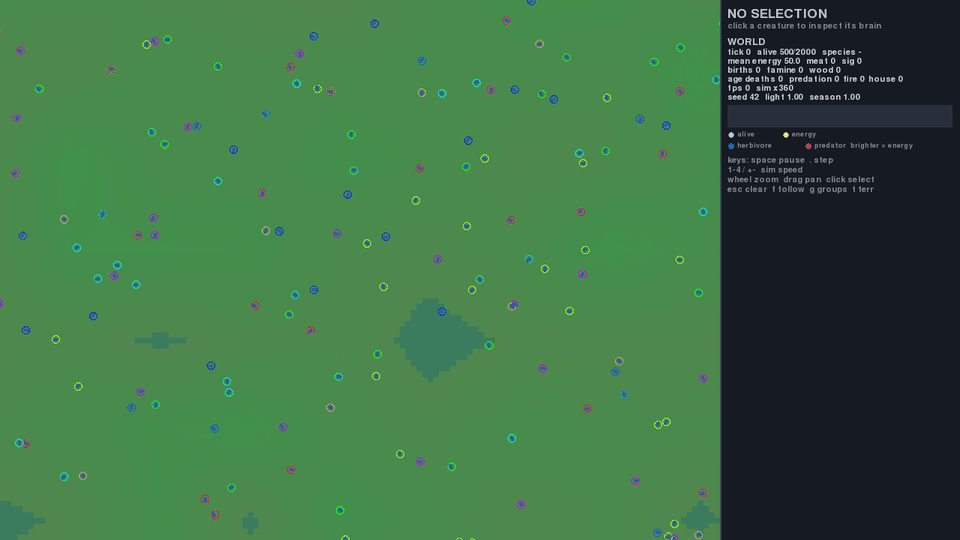
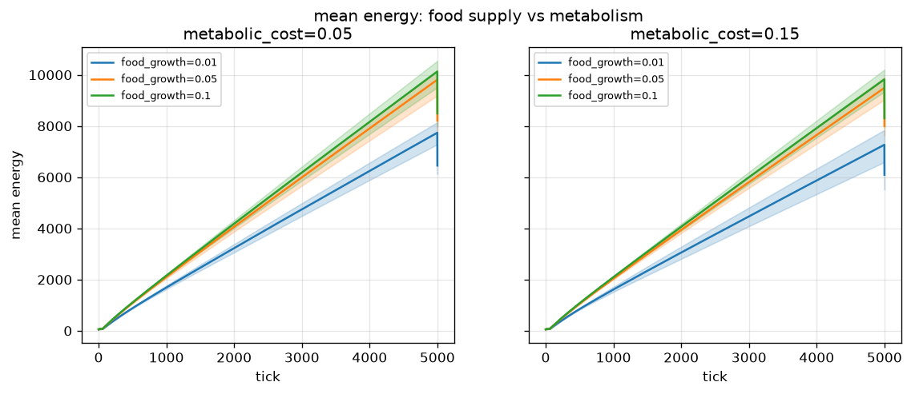
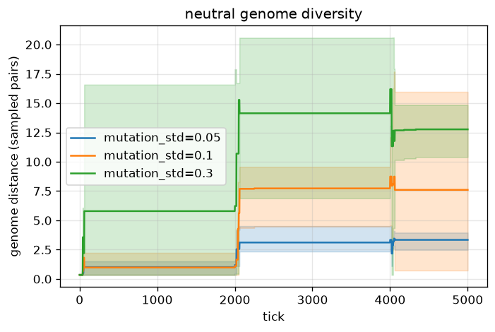
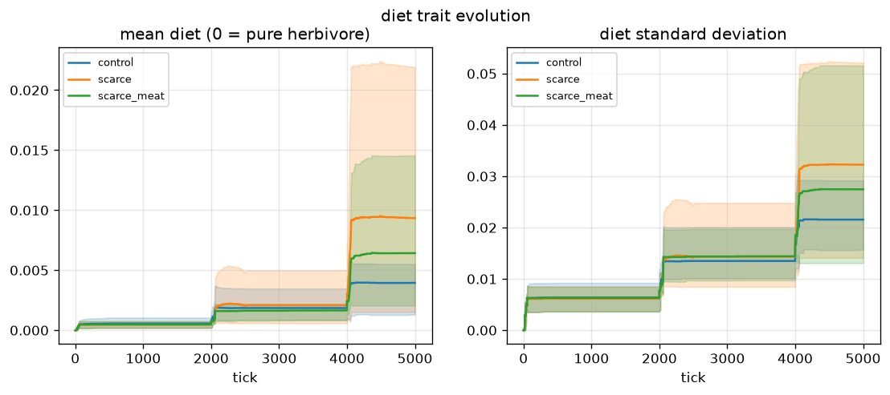
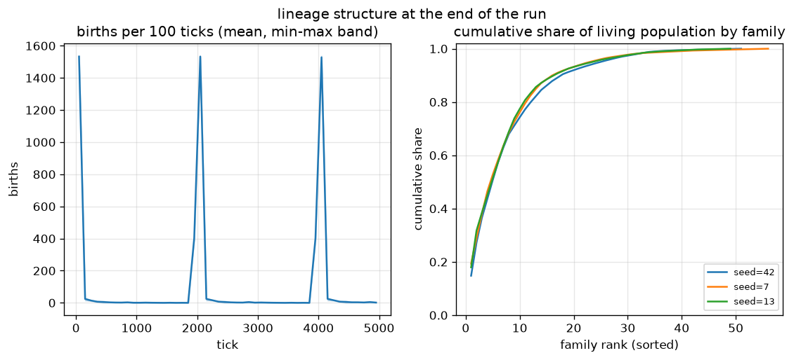

# Primordia



**A 2D ecosystem where neural creatures evolve by natural selection — there is
no fitness function anywhere.** Creatures that survive and accumulate energy
split in two; creatures that starve, age out, or get bitten die. Predation,
flocking, and herding are not programmed — either they emerge from selection
on the evolved body/brain traits, or they don't. This repo is an honest
attempt to find out which, with reproducible experiments and published
negative results.

```bash
pip install -e ".[render,dev]"
python run.py --seed 42                # windowed viewer
python run.py --seed 42 --headless --ticks 5000 --stats s42.npz
pytest -q
```

## How it works

- **No fitness, no objectives.** Energy is the only currency: eat food (or
  meat), pay metabolic and movement costs, and split when you cross
  `reproduce_threshold`. Death = energy ≤ 0, `max_age`, or a predator's bite.
- **Evolvable body and brain.** Each creature is a genome of 490 values: a
  35-input network (7-ray food sum, creatures, prey and carrion peak
  channels, left/right food antennas, internal state, ambient light, three
  signal-field sensors, the hue similarity of neighbours in the smell
  window, and the wood smell of that same window) → 9 hidden units with
  Elman recurrence → turn, accelerate, eat/attack, emit signal, donate
  energy, gather wood, build a campfire, build a house — plus
  body traits: max speed, size, vision range, *diet* (0 = herbivore;
  predation capability is itself a trait that has to evolve) and a
  heritable lineage hue — neutral by construction (nothing in the tick
  rewards it), shown as a ring under the sprite.
- **Sex and aging, not just cloning.** Reproduction is sexual: an initiator
  above the threshold searches for a nearby partner, each parent pays half
  the child's energy, and the genome is a per-gene crossover plus mutation.
  Old bodies wear out (`w = exp(senescence_rate * age)`): metabolism grows
  while speed and vision shrink. No partner → no birth: mobility and
  aggregation get selected without being programmed.
- **A world that pushes back.** Terrain fertility and lakes shape where food
  grows, a sun sets a day/night light cycle (vision shrinks at night), and
  seasons modulate growth — all pure physics from `Config`, no objectives.
- **Headless core, one-way rendering.** The core modules (`world`, `step`,
  `brain`, `genome`, `sensors`, `stats`, `io`) never import pygame or
  matplotlib; the viewer only reads state.
- **Deterministic.** Same `--seed` ⇒ bit-identical simulation on the same
  machine, including across save/load (`--save`/`--load` restore both RNG
  streams and the genealogy log).
- **Data-oriented.** Fixed-capacity SoA arrays with a free-list — no Python
  objects per creature, no allocation in the tick, spatial-hash neighbor
  queries, everything hot in Numba `@njit`.

## What I discovered

These are the results of the stage-8 experiments
([`experiments/`](experiments/)), 3 seeds × 5000 ticks each. Full method and
limitations in each experiment's README.

> **Reproducibility note.** The tables and figures below were produced on the
> pre-stage-9 tree (19-input, 12-hidden feedforward brains, uniform food
> field, the old food economy). Stage 9 changed the brain layout (28 inputs,
> 10 hidden units, Elman recurrence), stage 9.5 recalibrated the economy,
> stage 10 added a 29th input (ambient light) plus terrain/day-night/seasons,
> stage 11 switched to sexual reproduction, added senescence and carrion
> (30 inputs, `FORMAT_VERSION 4`), stage 12 widened the genealogy log
> with the mating partner and added the species/barrier stats columns
> (`FORMAT_VERSION 5`), stage 13 wired the common signal channel
> (33 inputs, a 4th brain output, `FORMAT_VERSION 6`), and stage 14 made
> that channel diffuse — a Jacobi pass spreads the field into trails
> (config-only, `FORMAT_VERSION` stays 6), while stage 15 added a neutral
> lineage hue (34 inputs, a 5th body trait, `FORMAT_VERSION 7`), stage
> 16 opened a donation channel (a 5th brain output gifting energy to the
> nearest neighbour, 9 hidden units, `FORMAT_VERSION 8`) and stage 17
> added the civilization base (a wood-smell input and three outputs for
> gather/build-fire/build-house, `FORMAT_VERSION 9`). The experiment
> scripts pin the old regime
> off via `STAGE8_BASE` so the *regime* is preserved — but reruns on current
> HEAD use the sexual dynamics; the original asexual runs stay in each
> experiment's gitignored `data/` cache (bit-exact reproduction needs the
> pre-stage-9 commit).

### 1. Energy grows without a ceiling — and the obvious knobs don't fix it

A 6-point sweep of `food_growth_rate {0.01, 0.05, 0.10}` ×
`metabolic_cost {0.05, 0.15}` left the population pinned at the cap in every
variant and mean energy climbing linearly (~1.43–1.87 e/tick). Root cause:
while the population sits at `max_creatures`, blocked reproduction costs the
parent nothing, so metabolism + movement are the only energy sinks and they
lose against intake. The knobs only change the slope, never the structure.



**Fix decided before publishing:** `max_age` 5000 → 2000. Continuous age
turnover frees slots, reproduction and mutation keep running all run long,
and mean energy settles into a bounded ~1000–4000 cycle instead of growing
without limit (~4400 age deaths and births per run instead of one cliff at
the final tick).

**Stage 9.5 follow-up:** the missing knob was the *scale* of the food
economy, not its slope — `food_capacity` 100 → 3, `eat_rate` 4 → 1,
`food_growth_rate` 0.05 → 0.02, `metabolic_cost` 0.05 → 0.08. Offer now
matches demand: over 10k ticks the population sits at mean 1342–1734 with
minima of 185–295 (below the 2000 cap), famine is the second death cause
(11–27% of deaths), and only 1–32% of survivors sit above the reproduction
threshold at any time. Selection finally has something to act on.

**Stage 10 update:** terrain fertility (mean ~0.43) and daylight (mean 0.75)
cut effective food supply ~60%, so `food_growth_rate` was recalibrated
0.02 → 0.12 (sweep 0.04–0.27, 2 seeds × 6000 ticks). With the environment
on, 3 seeds × 10k ticks hold pop mean 1058–1436 (min 110–161), famine
26–37% of deaths, 1–11% of survivors above the threshold — and creatures
live on cells ~0.17–0.22 more fertile than the map average, with total
food tracking the season (r = 0.39–0.59) and ~5% more food by day than at
night.

### 2. Mutation controls spread, not direction

Sweeping `trait_mutation_std {0.05, 0.10, 0.30}` moves final sampled genome
distance **3.34 → 7.60 → 12.77** monotonically with no viability cost, but
trait *means* barely move (±1%). Over this window what we measure is
evolutionary **drift**, not directional selection — and diversity only grows
in steps, at the turnover pulses, because mutation happens at birth.



### 3. Predation did not emerge (negative result)

Starting from an all-herbivore population (diet = 0 at spawn), neither food
scarcity nor a richer meat reward produced meaningful predation: diet_mean
stays ≤ 0.0093 and predation kills **0 / 3 / 2 per run** against ~4000
old-age deaths. The likely trap: bite budget is `bite_rate × diet`, so near
diet ≈ 0 meat cannot pay for itself, and diet cannot grow without meat
paying. Publishing this as-is — an honest negative beats a cherry-picked
gif.

*Stage 9.5 update:* with the scarcer economy (and a steak now worth more
relative to a shrinking energy budget), predation first went nonzero: every
one of 3 seeds × 10k ticks records predation deaths (1–64 per run), and the
top 1% of evolved diets reach 0.17–0.22. Still a trickle, not a food web —
and stage 12 (below) confirms the trickle never became a pyramid, while
showing it *does* shape genome isolation.

*Stage 10 update:* denser populations at the new food economy raise encounter
rates — predation over 3 seeds × 10k goes 1926 / 2 / 1 deaths (seed 42:
essentially zero until tick 7k, then an omnivore outbreak during the final
boom at the cap). High variance, still no obligate predator above diet 0.5
alive at any snapshot — same open problem, bigger numbers.

*Stage 12 update:* measuring rather than tuning, the trophic pyramid is
still flat (≥99.9% of every run is herbivore, 0 predators alive, famine
dominates deaths), but the *structure* question the stage asked did answer:
genome clusters grow 1 → ~18 over 10k ticks and a small, sustained
reproductive barrier emerges (mean cross-cluster mating fraction 0.100 with
meat reward vs 0.057 with `bite_efficiency = 0`). Predation remains 1.5% of
all deaths — a trickle with a measurable downstream effect on isolation,
not a food web. See `experiments/ecology/`.



### 4. A few families dominate the survivors

With `max_age = 2000` turnover, ~5600 births per run come in sharp pulses
(synchronized cohorts refilling LIFO-freed slots). Of the 500 founders only
**49–56 families** survive to tick 5000, and the **top 10 account for 74–77%
of the population**; median lineage depth 6–7 generations.



## Viewer

`python run.py --seed 42` opens the pygame-ce window: drag to pan, wheel to
zoom, click a creature to inspect its brain (per-layer weights including
the recurrent matrix, firing activity), space to pause, `1-4` to change sim
speed. The camera follows the selection with a trail, births and deaths
flash in place, and the side panel shows population, births, deaths by
cause, and mean energy live (sparkline in overview mode). The world renders
terrain under the food layer (blue lakes, shorelines, fertile ground) and
the whole scene dims with the day/night cycle shown as `light` in the HUD.

## Performance

Target: ≥ 30 ticks/s at 2000 creatures headless (i5-8265U, no GPU).

| creatures | ticks/s (load 6.9–7.4, stage-17 default) |
|---|---|
| 500 | 127–134 |
| 2000 | 92–136 |
| 5000 | 42–124 |

Numbers vary 2–4× between processes depending on machine load (this box runs
a desktop session); compare A/B in the same session. Stage 17 added five
phases (wood growth, structure decay, gather, build, structure rebuild)
that together cost ~138 µs/tick ≈ **1.2%** of the tick at N=2000 (profile:
11/4/33/44/47 µs) — the table's wide range is the machine's load 7, not the
new phases, and the 30 ticks/s floor at N=2000 holds with 3–4.5× margin.
Stage 16's donate phase (0.75 µs at default, ~24 µs when gifts are active)
and earlier per-phase costs are listed in `AGENTS.md`. The stage-10 economy
holds different populations than older tables during a 1000-tick bench
(alive_final 82/480/853), so they are not directly comparable to earlier
runs. `python -m primordia.bench [--profile]` reproduces the table.

## Reproduce everything

```bash
# experiments (data/ cached in npz, figures regenerate)
python experiments/food_supply/run.py
python experiments/mutation_diversity/run.py
python experiments/predation/run.py
python experiments/lineage/run.py
python experiments/tags/run.py          # stage 15: neutral lineage hue
python experiments/proto_culture/run.py --phase pilot  # stage 16: donation
python experiments/proto_culture/run.py --phase gate
python experiments/civilization/run.py --phase pilot   # stage 17: wood/fire/houses
python experiments/civilization/run.py --phase gate --house-energy 12
python experiments/civilization/run.py --phase gate --house-energy 1000000  # control

# stats + plots
python run.py --seed 42 --headless --ticks 5000 --stats s42.npz
python plot.py s42.npz --out figs/

# save / load (bit-identical continuation)
python run.py --seed 42 --headless --ticks 5000 --save w5k.npz
python run.py --load w5k.npz --headless --ticks 500

# demo GIF (what you see at the top of this README)
python run.py --seed 42 --headless --ticks 9000 \
    --record docs --record-every 360

# JSON config overrides (copy overrides.example.json and edit fields;
# unknown field names are rejected loudly)
python run.py --headless --ticks 1000 --config overrides.example.json
```

## Project layout

```
primordia/
  config.py   world.py   genome.py   brain.py   sensors.py
  step.py     stats.py   io.py       bench.py   ecology.py
  render/     # pygame viewer + headless GIF recorder (never imported by core)
tests/        # 206 tests: determinism, invariants, save/load, guards
experiments/  # one script + README per experiment
run.py        # CLI: --seed --headless --ticks --load --save --stats
              #      --config --record --screenshot --select
```

## Roadmap status

Stages 1–17 of the plan are implemented: world+food, brain+sensors,
genome+reproduction, viewer, evolvable predation, stats/plots,
save/load+genealogy, experiments/demo/publication, the guided-world stage
(persistent food patches, richer senses, Elman recurrence, a richer
viewer), the balance stage (food economy recalibrated, turning now costs
energy, larger sprites), the environment stage (terrain, water,
day/night light, seasons), the biology stage (sexual reproduction,
senescence, carrion/smell), the ecology stage (diet-class gauges,
genome clustering, reproductive-barrier metric — no new tick logic,
measured results in `experiments/ecology/`), the signal channel (stage 13:
a scalar emit gate and smell sensors, no reward), pheromone diffusion
(stage 14: the field spreads into trails — physics confirmed in
`experiments/trails/`, interpretation still null at 10k), the lineage
hue (stage 15: a neutral heritable colour plus a neighbour-hue-similarity
input and sprite rings — no reward anywhere, yet in 3 seeds × 10k
(`experiments/tags/`) families occupy windows 9–23× denser than a random
spawn and hues align 1.5–19× beyond spacing alone, while global diversity
drifts seed-dependently; structure ≠ sensor use, stated as a limitation),
donation (stage 16: a 5th brain output gifts energy to the nearest
neighbour — in 3 seeds × 10k (`experiments/proto_culture/`) the channel
survives at both prices, gift pairs align 2.6–4.7× beyond chance (kin
receives), the cheap gate does not close while the dear one falls only
6% — selection against the leak exists but is slow; the tick never
rewards giving), and the civilization base (stage 17: wood as a carried
resource, campfires that cook, houses that shelter — in 10k
`experiments/civilization/` the fire/cooking economy survives 3/3 runs
while houses collapse it ~10× and extinct 1/3 of seeds even at half the
price; selection does close the build spam, but only after the
demographic damage — honest negative on housing, documented in the
experiment's README). The "real world" roadmap continues with daemon /
territory / Oja. Known open
problems are documented above (predation still a trickle, creatures still
circle) rather than hidden.

## License

MIT — see [LICENSE](LICENSE).
