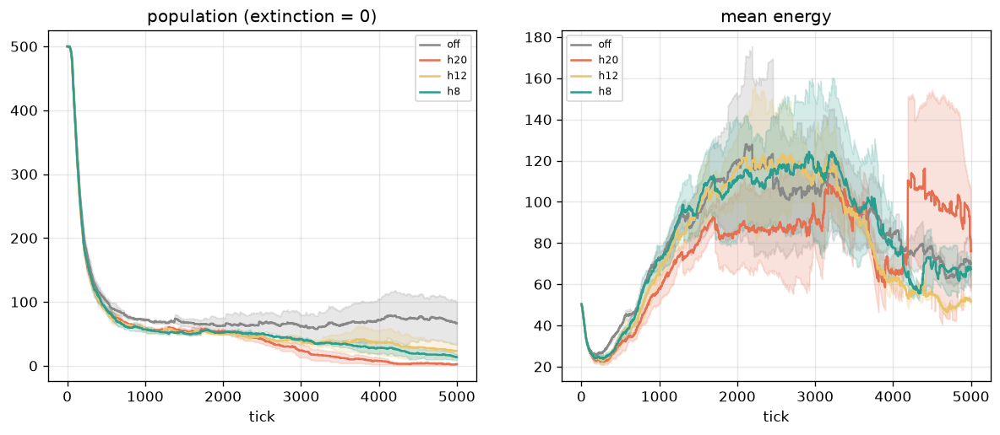
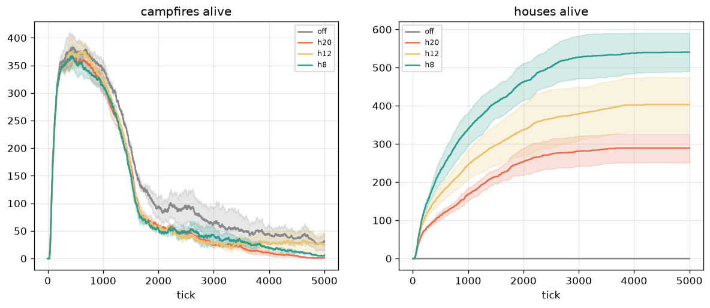
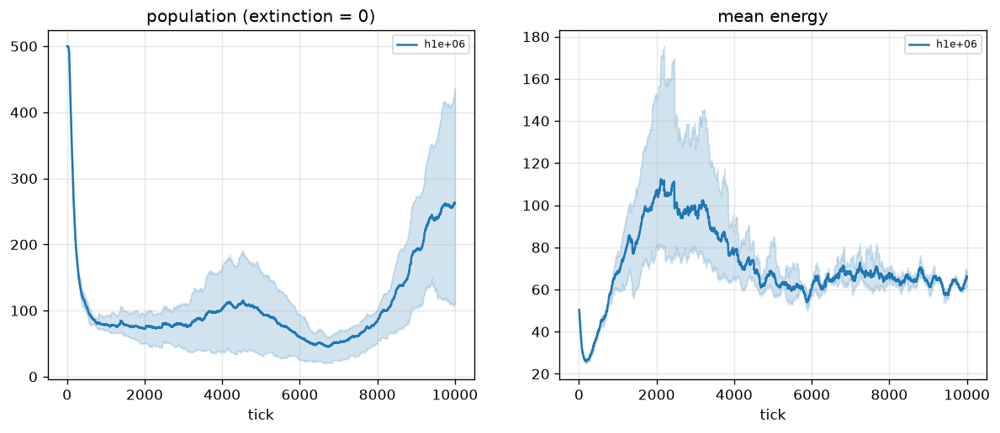
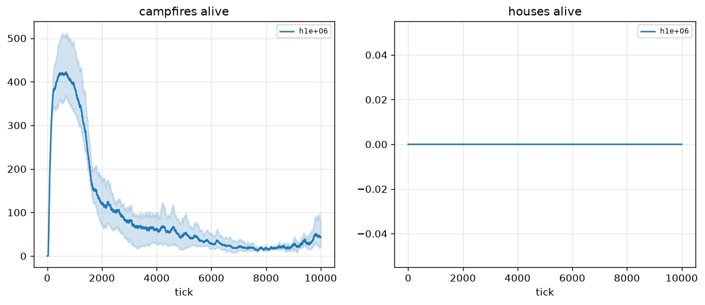
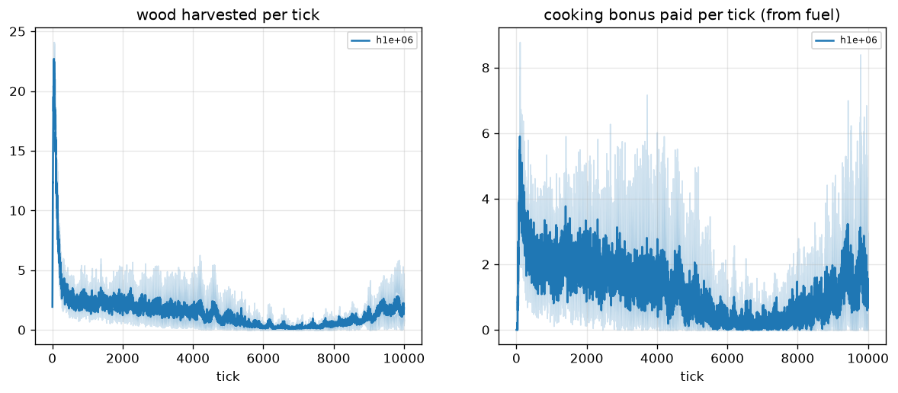

# Stage 17 — civilization: does building pay, or is a house a trap?

## Question

Stage 17 gave the brain three new decisions and a new resource: carry
wood (`gather`), raise a campfire (`build_fire`), raise a house
(`build_house`). Nothing rewards building (principle 1): a fire pays
only if the cooking bonus (`cook_bonus`, paid 1:1 from the fire's fuel)
outweighs the energy the fuel once cost, a house pays only if shelter
(`cover_reduction` against bites) ever matters — in `proto_culture`
predation is real but rare. Whether builders outlive non-builders is
selection's answer, not a rule.

Before asking that, the world has to stay alive. Two facts from the
stage-17 plan forced a calibration first:

- the plan shipped `house_wood_cost=6.0` against a `max_inventory` of
  **4.0** — inventory is the only wood depot, so houses were
  *unbuildable by construction* (fixed: cost 4.0 + a Config guard that
  rejects any wood price above the pack size);
- with the price fixed, seed 42 built 370 houses in 3k ticks and the
  population collapsed (500 → 37, births 259 → 26) while the same world
  with unbuildable houses recovered to 201.

## Hypothesis (stated a priori, before any run on this code)

> **H1 (price drives the collapse):** final pop and births rise as
> `house_energy_cost` falls (monotone over 20 > 12 > 8). If 8 is no
> better than 20, price is not the cause and the README says so.
> **H2 (the fix must not kill the fire):** `n_fire` max > 0 and
> `energy_cooked` total > 0 in every variant — wood, pack and energy are
> shared, so a house fix that extinguishes campfires fails.
> **Hard gate (gate phase):** all runs reach 10k with `min alive > 0`;
> mean final pop < 0.95 · cap; fraction of ticks with
> `mean_energy >= reproduce_threshold` < 0.5.
> **Measured (gate phase):** `n_fire` > 0 in ≥ 2/3 runs;
> `energy_cooked` > 0; `wood_gathered` > 0; `n_house` ≥ 1 in ≥ 2/3 runs.
> **Null is publishable:** if even the cheap house collapses,
> proto_culture cannot host houses yet — numbers to the user, no hacks.

One amendment, disclosed: the `off` control (a house price nobody can
pay — payment is all-or-nothing) was added **after** the first pilot
pass showed every house variant collapsing, to separate "houses
collapse the world" from "proto is at its limit". The gate-phase
criteria above were registered in `run.py`'s docstring before any gate
run.

## Method

`configs/proto_culture.toml` (reach predation, emit cost 0.05), stats
every tick, sequential runs (the Numba RNG is process-global).

| phase | variants | seeds × ticks |
|---|---|---|
| pilot | `off` (1e6), `h20` (20), `h12` (12), `h8` (8) | 42, 7 × 5k |
| gate | `off` (control), `h12` (pilot's best house) | 42, 7, 13 × 10k |

`house_wood_cost` stays at the affordability guard's 4.0 everywhere.




## Results

### Pilot (5k, 2 seeds)

| variant | final pop (mean/min) | births | houses max/final | cooked total |
|---|---|---|---|---|
| `off` | **66 / 33** | 186 | 0 / 0 | 6 611 |
| `h20` | 2 / 1 | 46 | 327 / 289 | 3 822 |
| `h12` | 24 / 12 | 92 | 475 / 404 | 5 302 |
| `h8` | 14 / 9 | 66 | 591 / 540 | 4 004 |

- **H1: partially confirmed, not monotone.** 20 → 12 improves the final
  population 12× and doubles births, but 8 is *worse* than 12 — the
  cheaper house built 591 times (spam: ~50% of raw logits sit above the
  0.5 decision line, so every full pack becomes another house) and the
  extra volume cancels the lower unit price. Price *and* volume matter.
- **H2: confirmed.** Campfires stay alive in every variant (max
  381–409) and cooking pays 3.8k–6.6k energy; the wood economy itself
  is not the problem.

### Gate (10k, 3 seeds): control vs treatment

| @10k | `off` (no houses) | `h12` |
|---|---|---|
| final pop (mean / min) | **262 / 110** (434, 110, 243) | 24 / **0** (31, 40, **extinct @8317**) |
| hard gate | **PASS** | **FAIL** (seed 13 extinct) |
| births total | 804 | 169 |
| `n_house` max / final | 0 / 0 | 501 / 436 |
| `n_fire` max / final | 513 / 43 | 496 / 6 |
| `energy_cooked` total | 12 085 | 7 401 |
| frac(ticks `mean_energy ≥` threshold) | 0.083 | 0.129 (both < 0.5 ✓) |
| measured criteria | fires ✓ cook ✓ gather ✓ (`n_house` 0/3 by construction) | **all PASS** (fires 3/3, houses 3/3, cook, gather) |





**Reading.** The wood + fire + cooking world survives (control: 3/3
alive, hard gate PASS). Adding houses costs ~10× the population and
extinguishes one run in three. House construction *does* stop growing
after ~5k ticks in every run (`n_plateau`: 475→475, 332→332, 501→501) —
consistent with selection finally closing the spam gate — but the
population is already at ~15 when the plateau arrives. Selection finds
the trap; not before the demographic damage.

## Limitations

1. **n = 2 (pilot) / n = 3 (gate).** The non-monotone `h8` result is
   one seed pair away from noise; the "volume cancels price" reading is
   a hypothesis consistent with `n_house`, not a measured gate
   distribution (no stats column records `build_house` logits).
2. **The control was added mid-pilot** (disclosed above); its hard-gate
   PASS is not an independent pre-registered replication.
3. **The `frac` criterion uses `mean_energy`**, because the stats
   record the mean, not the per-creature energy distribution — a
   weaker proxy than the stage-10/11 gate, which is why both variants
   pass it easily.
4. **Baseline shifted since stage 16.** The control ends at 262 mean
   (110–434) on the same toml where stage 16's donation control ended
   at 845 — the wood/fire economy itself costs population even when it
   survives. The `wood_field` also draws RNG after spawn, so trajectories
   are not comparable run-for-run across stages.
5. **Houses were never *useful* here** — cover only matters under
   predation pressure, which proto_culture applies rarely in 10k ticks.
   A world where shelter pays may still be worth building; this
   experiment only says the price of finding out is lower than 20.

## Reproduce

```bash
python experiments/civilization/run.py --phase pilot            # 2 × 5k × 4
python experiments/civilization/run.py --phase gate --house-energy 12
python experiments/civilization/run.py --phase gate --house-energy 1000000  # control
```
