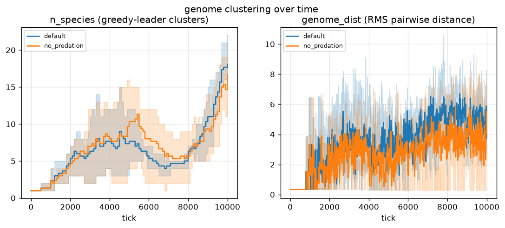
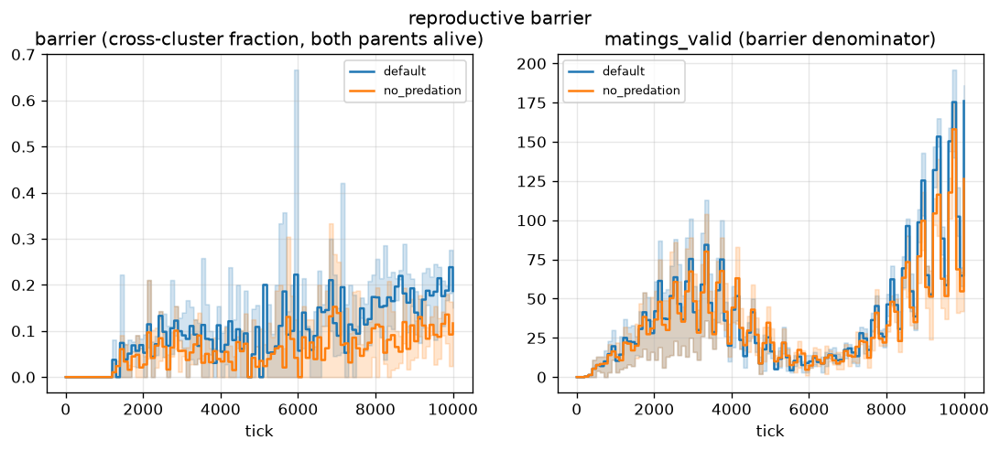
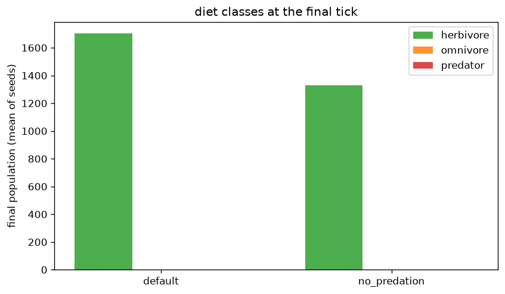
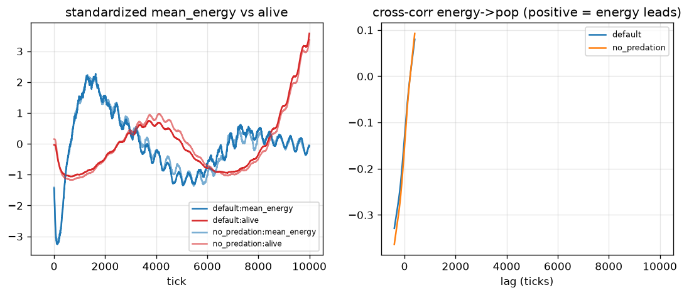

# Do species clusters and a reproductive barrier emerge?

## Question

Stage 11 gave the population real sexual reproduction (partner search +
crossover + mutation), which is the prerequisite for speciation: identical
clones are gone, so genome clusters *can* form. Stage 12 asks whether they
**do**, and whether the clusters that form actually **refuse to mix** —
i.e. whether a reproductive barrier emerges on its own, and how much of
that structure is maintained by predation.

There is no fitness term and no "species" rule anywhere in the tick. The
only mechanism available is honest physics: proximity-limited mating
(`mate_range`), mutation-driven genome drift, and the stage-10 niches
(terrain / water / day-night / seasons) that make different genotypes
succeed in different places. If isolation appears, it has to come from
genotypes segregating *spatially* far enough that partners found within
`mate_range` tend to share a cluster.

## Method

2 variants x 3 seeds (42, 7, 13) x 10000 ticks, per-tick stats recorded on
the **current HEAD** Config defaults (terrain, day/night, seasons, carrion,
sexual reproduction all active — this experiment is about where the
simulation is *now*, not about the pinned stage-8 regime used by the older
experiments):

| variant | overrides |
|---|---|
| default | none (`bite_efficiency` 0.3, the calibrated stage-11 value) |
| no_predation | `bite_efficiency` 0 (herbivory only) |

`no_predation` isolates the effect of meat on structure: if clusters and
the barrier weaken without predation, meat was doing the segregating.

```bash
python experiments/ecology/run.py          # uses data/ cache
python experiments/ecology/run.py --force  # recompute
```

Stage-12 stats columns sampled every `cluster_every = 100` ticks
(forward-filled in between, exactly like `genome_dist`):

- **`n_species`** — greedy-leader clusters over the living genomes
  (`primordia/ecology.py`, threshold `Config.species_threshold = 10.0`,
  calibrated from the pairwise-distance histogram of a real 3000-tick run:
  distances are bimodal, median ~7.5 with a far tail to ~370, so K is flat
  over `[8, 50]` and lands 5–15; 1.0 would return K ~= N).
- **`barrier`** — fraction of logged births since the last sample whose
  **two living parents** carried *different* cluster labels. This is the
  isolation metric: a barrier of 0 means every observed mating was
  within-cluster.
- **`matings_valid`** — the denominator of `barrier` (births where both
  parents were still alive at the sample). It is printed, not hidden, so a
  low denominator (noisy ratio) is visible.
- **`n_herbivore` / `n_omnivore` / `n_predator`** — diet-class gauges over
  living slots (`classify_diets`: diet < 0.33 herbivore, > 0.66 predator,
  else omnivore). Counting only, never a rule.
- **`genome_dist`** — sampled RMS pairwise genome distance (stage 6).

## Result






| variant | final pop | mean n_species | mean barrier | mean matings_valid | predation deaths | genome_dist (final) |
|---|---|---|---|---|---|---|
| default | 1703 | 6.3 | 0.100 | 38 | 43 | 5.59 |
| no_predation | 1330 | 6.8 | 0.057 | 34 | 13 | 4.22 |

(Means over the 3 seeds. Death column is the total per run.)

**A weak but real reproductive barrier emerged, and predation roughly
doubles it.**

1. **Clusters form and keep forming.** `n_species` starts at 1 (all
   founders, fresh spawn) and climbs monotonically to ~18 by tick 10k in
   both variants. The population is never one panmictic blob after the
   first thousand ticks.
2. **The barrier is small but sustained and clearly nonzero.** Mean
   `barrier` over the whole run is 0.100 (default) / 0.057
   (no_predation); measured only over ticks where it is defined
   (`matings_valid > 0`) it is 0.166 / 0.112 after the midpoint, and
   `barrier > 0` on 85% / 70% of post-midpoint ticks. So ~1 in 7–9
   observed matings is cross-cluster — isolation is *partial*, not
   complete, which is what you expect from proximity-limited mating with
   no assortative-preference gene.
3. **Predation buys structure.** Turning meat off (`bite_efficiency` 0)
   drops the final `genome_dist` 5.59 -> 4.22, the mean barrier
   0.100 -> 0.057, and predation deaths 43 -> 13 per run. The residual 13
   "predation" deaths in `no_predation` are the honest floor of the metric
   (see Limitations). Meat appears to *amplify* existing genome
   differences rather than create them: clusters form either way
   (`n_species` is actually slightly higher without predation), but the
   ones under predation are further apart and refuse more matings.
4. **Isolation tracks diversity, not raw population.** Cross-correlation
   over seeds: `alive -> n_species` peaks at lag ~60 ticks with r = +0.86
   (default) / +0.74 (no_predation) — growth *precedes* splitting, so new
   clusters are born from expansion, not the reverse. `n_species ->
   barrier` is contemporaneous at r = +0.46 / +0.33: more clusters, more
   cross-cluster matings, as geometry alone predicts.
5. **No Lotka-Volterra cycles.** `mean_energy -> alive` peaks only at the
   400-tick edge of the window with r <= 0.09, and `alive -> mean_energy`
   is contemporaneous and *negative* (r = -0.13 / -0.15): crowding drains
   energy, but there is no delayed predator lag to oscillate against.
   This is consistent with the trophic picture in the diet gauges.
6. **The trophic pyramid is still flat.** Every seed stays
   >99.9% herbivore for the entire run (at most 1 omnivore ever alive,
   0 predators); famine dominates deaths (2835 / 2800 per run vs 43 / 13
   predation). Predation is 1.49% of all deaths (default) / 0.46%
   (no_predation). The diet trait is active but has not built a predator
   population in 10k ticks.

**In short: speciation-lite is real and measurable, it is *not* driven by
predation (clusters form without meat), but predation makes the clusters
more distinct and the barrier ~2x stronger. A predator trophic level did
not emerge.**

## Limitations

- **`barrier` is a lower bound and biased low.** It only counts births
  whose two parents are *still alive at the next 100-tick sample*; a
  short-lived parent's mating is dropped from the denominator. With
  `max_age = 2000` and famine turnover, a nontrivial share of matings is
  unobserved. The bias is the same in both variants, so the *comparison*
  (0.100 vs 0.057) is sound; the absolute level is not.
- **`species_threshold = 10.0` is a metric choice, not a biological fact.**
  It was calibrated for stability (K flat over `[8, 50]`) but a different
  threshold rescales `n_species` and `barrier` together. The qualitative
  result (default > no_predation) holds across that range; the exact
  numbers do not.
- **Greedy-leader clustering is order-dependent.** Leaders are assigned by
  ascending slot index, so two runs with the same genomes but a different
  slot order could label a boundary creature differently. This is
  deterministic per seed (so all figures are reproducible) but it means
  `n_species` is not a canonical partition of the genome cloud.
- **The `no_predation` floor is not zero.** `bite_efficiency = 0` zeroes
  the *attacker's gain*, not the drain: a contact bite still subtracts
  `take` from the victim (`step.py`), so a `diet`-carrying neighbour can
  still empty a low-energy victim and register a predation death. That is
  why `no_predation` records 13 deaths/run (vs 43). The variant therefore
  removes the *reward* for hunting, not the *act* — a weaker isolation of
  "meat's effect" than a pure kill-switch, and the honest reading of the
  0.100 vs 0.057 barrier gap is "meat reward roughly doubles it", not
  "predation is required for it".
- **10k ticks / 3 seeds.** The barrier is still climbing at the end of the
  run (`n_species` is monotone); longer runs would likely show a higher
  absolute barrier in both variants. Whether the default/no_predation gap
  widens or closes is unknown.
- **Seasonality is on** (`season_period = 8000`), so each run covers ~1.25
  seasonal cycles. Any seasonal modulation of the barrier is inside the
  noise of n=3 and was not separated.

## Reproducibility

Figures and numbers here were produced on the stage-12 HEAD with
`python experiments/ecology/run.py --ticks 10000`. The 3-seed set (42, 7,
13) and `cluster_every = 100` are pinned in the script. Raw per-tick
histories live in the gitignored `data/` cache (regenerable); the committed
artifacts are the four PNGs in `figs/` and this README.
