# Can Config-only levers break the predation ratchet?

## Question

Stage 8's predation experiment documented a ratchet: bite budget =
`bite_rate * gate * diet`, so at `diet ~ 0.01` a bite drains ~0.04
energy/tick — far below foraging income. Meat cannot pay for itself while
diet is low, and diet cannot grow without meat paying. Stages 9.5–12
recalibrated the economy but never isolated whether raising `bite_rate`
(the single knob that scales the budget) plus a larger contact radius
(longer effective contact per encounter) is enough — with no tick change,
no default change, no fitness term.

This experiment asks exactly that: **Config-only**, can predation become a
real trophic pressure (≥100 deaths/run) and can diet leave the ratchet
zone (max diet > 0.5, i.e. an "obligate predator" gauge)?

## Hypothesis (stated a priori)

The ratchet is economic, not structural. Config-only levers that raise
bite throughput (`bite_rate`, `contact_range`) will push `diet_max` past
~0.4 and produce predation in the hundreds per run, but the strict gate
(diet > 0.5 alive in 3/3 seeds at 10k) will **not** be reached because
dilution-by-crossover keeps regressing lineages toward the herbivore
majority. That is the prediction the gate phase tests.

## Method

Screening (phase A): 8 configs × 3 seeds (42, 7, 13) × 6000 ticks on
current HEAD defaults (terrain, day/night, seasons, sexual reproduction
active — not the pinned stage-8 regime). Only `Config` overrides differ
between variants; no code path changes.

| variant | overrides |
|---|---|
| base | none (control) |
| bigbite | `bite_rate=12` |
| bigbite+ | `bite_rate=24` |
| reach | `bite_rate=12, contact_range=2.5` |
| scarce | `bite_rate=12, food_growth_rate=0.06` |
| meatloop | `bite_rate=12, bite_efficiency=0.9, carrion_yield=0.6` |
| flat | `bite_rate=12, terrain_amplitude=0` |
| aggressive | `bite_rate=24, contact_range=2.5, food_growth_rate=0.06, bite_efficiency=0.9` |

Gate (phase B): the `base` control plus the two strongest screening
candidates (`reach`, `bigbite+`) re-run at 10000 ticks × 3 seeds
(`--phase gate`).

New stats columns (stage 12.5 instrumentation, no tick change):
- **`diet_max`** — max diet trait over living slots; `> 0.5` at the final
  tick means at least one "predator-class" creature is alive.
- **`diet_p50` / `diet_p90` / `diet_p99`** — percentiles of the diet
  trait over living slots (sampled every `sample_every` ticks,
  forward-filled). The ratchet question is not "did one outlier climb"
  but "did the body of the population move"; `p50 ≤ p90 ≤ p99 ≤ diet_max`
  is asserted by the test suite.
- **`bite_herb` / `bite_omni` / `bite_pred`** — per-tick counts of
  successful takes grouped by the *attacker's* diet class
  (< 0.33 / 0.33–0.66 / > 0.66). Separates "herbivores nipping" from
  real predation deaths.
- **`meat_eaten`** — per-tick delta of `World.meat_eaten` (carrion energy
  actually extracted).

```bash
python experiments/predator_survival/run.py                # screening, 6000 ticks
python experiments/predator_survival/run.py --phase gate   # gate, 10000 ticks
python experiments/predator_survival/run.py --force        # recompute (ignore cache)
```

## Result — screening (6000 ticks)

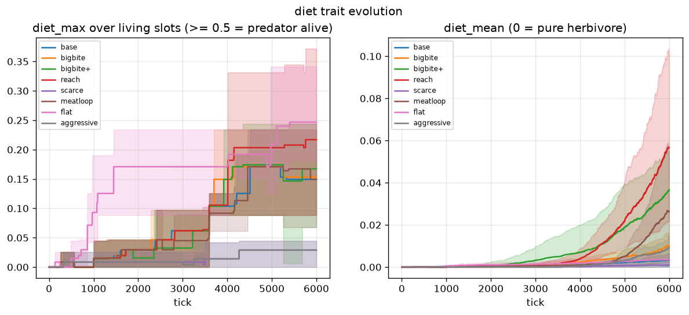
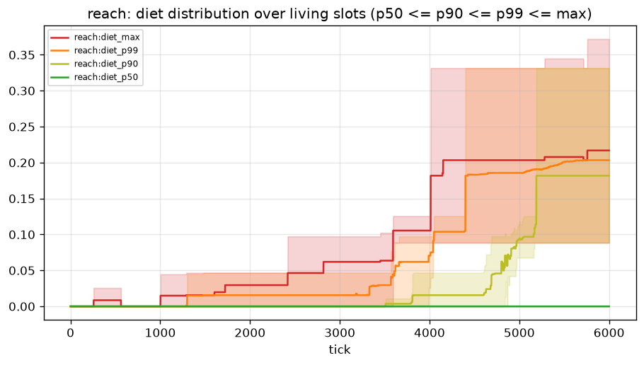
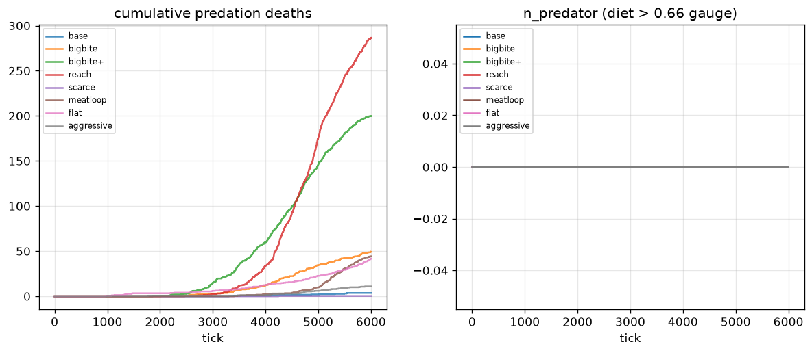
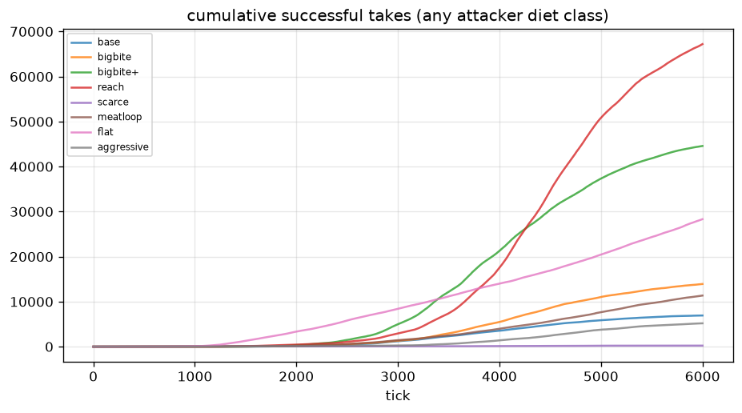
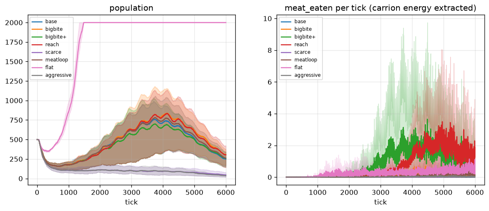
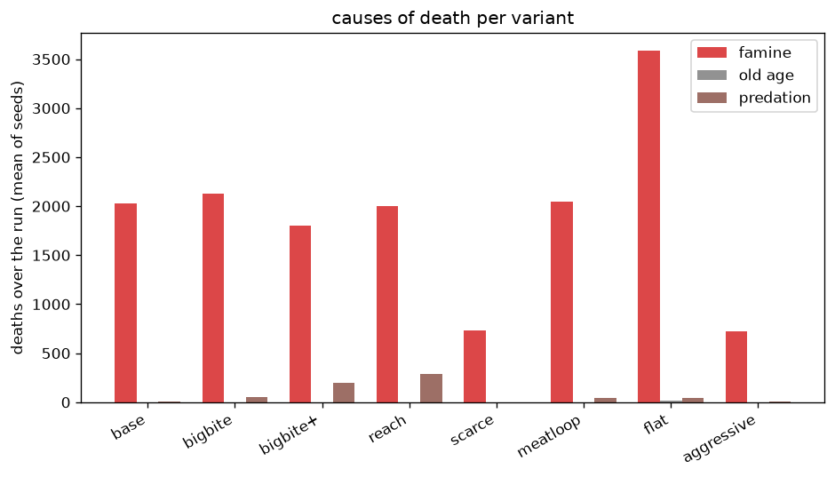

| variant | final pop | final diet_max | diet p50/p90/p99 | predation | takes h/o/p | meat_eaten | famine |
|---|---|---|---|---|---|---|---|
| base | 250 | 0.149 | 0.000/0.000/0.071 | 4 | 6919/0/0 | 85 | 2024 |
| bigbite | 305 | 0.153 | 0.000/0.020/0.146 | 49 | 13917/0/0 | 720 | 2126 |
| bigbite+ | 259 | 0.167 | 0.016/0.134/0.141 | 200 | 44576/0/0 | 4847 | 1805 |
| reach | 304 | 0.217 | 0.000/0.182/0.203 | 287 | 63267/3941/0 | 4246 | 2001 |
| scarce | 45 | 0.029 | 0.000/0.000/0.015 | 0 | 228/0/0 | 6 | 731 |
| meatloop | 262 | 0.149 | 0.000/0.120/0.142 | 44 | 11350/0/0 | 453 | 2046 |
| flat | 2000 | 0.247 | 0.000/0.000/0.099 | 42 | 28312/4/0 | 1503 | 3589 |
| aggressive | 37 | 0.029 | 0.000/0.029/0.029 | 11 | 5184/0/0 | 70 | 723 |

(Means over 3 seeds; death/meat/takes columns are run totals.)

**The ratchet breaks with high `bite_rate` + larger `contact_range`.**
`reach` and `bigbite+` record 287 and 200 predation deaths vs 4 in the
control — a 50–70× increase — and meat actually flows (4246 / 4847 energy
extracted vs 85). The takes breakdown shows *who* is biting: in `reach`,
3941 takes come from omnivore-class attackers (diet 0.33–0.66), the rest
from herbivores nipping; in every other variant (and `base`) all takes
are herbivore-class. **No take in the whole screening comes from a
predator-class attacker** (`bite_pred = 0` everywhere): diet has left the
ratchet zone but has not yet reached the apex. `scarce` and `aggressive`
collapse to pop 37–45 (food too tight: `food_growth_rate=0.06` starves
the population before diet can rise). `flat` (no terrain) pins the pop at
2000 with the highest `diet_max` (0.247) but low predation (42): abundant
uniform food makes bites common but rarely lethal (victims have energy to
spare).

## Result — gate (10000 ticks, base + top 2)

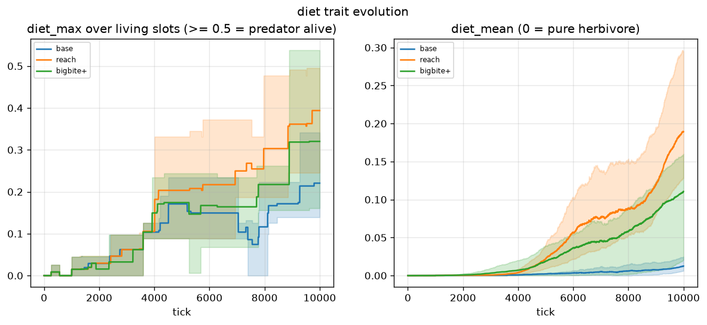
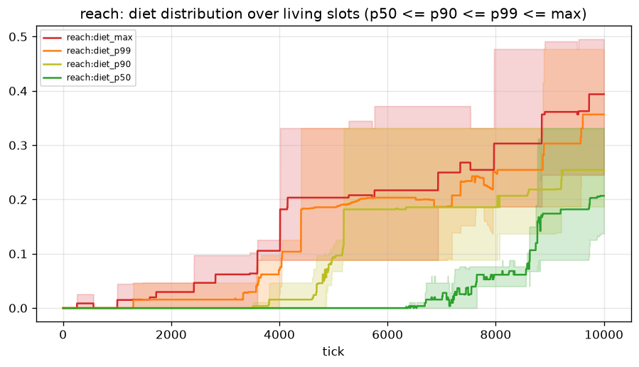
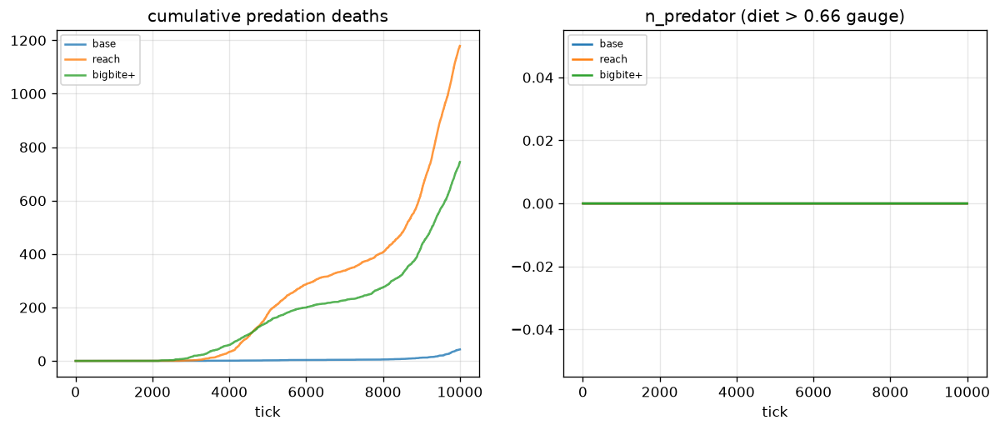
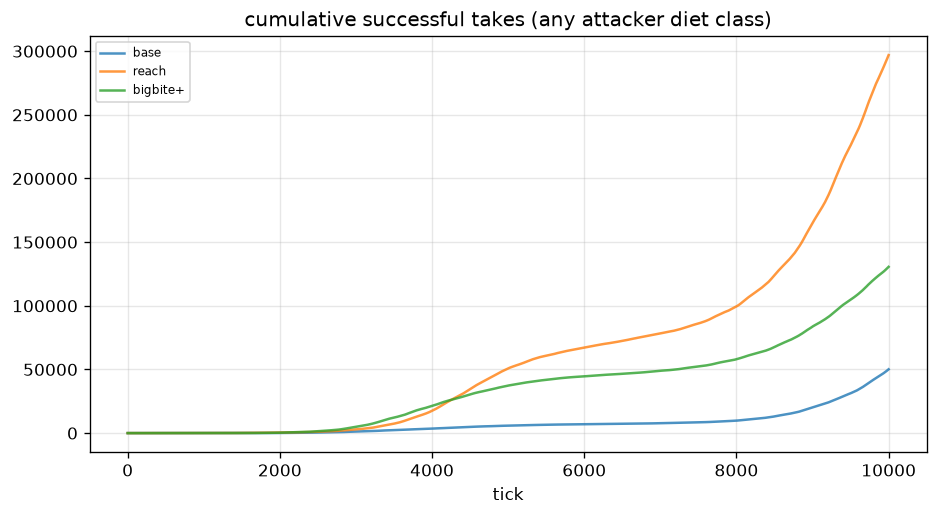
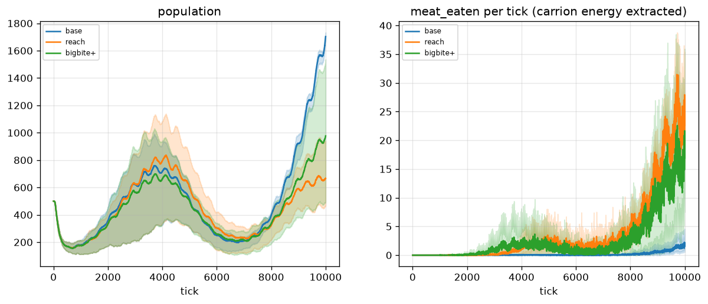
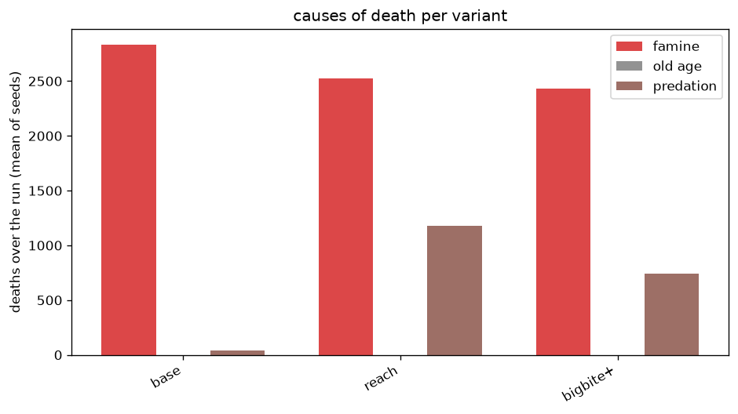

| variant | final pop | final diet_max (min / max across seeds) | diet p50 (final, mean) | predation | takes h/o/p | meat_eaten |
|---|---|---|---|---|---|---|
| base | 1703 | 0.221 (0.139 / 0.341) | 0.000 | 43 | 49986/130/0 | 1505 |
| reach | 667 | 0.394 (0.245 / **0.495**) | 0.207 | 1179 | 255824/41111/**0** | 37265 |
| bigbite+ | 977 | 0.320 (0.161 / **0.538**) | 0.105 | 745 | 130470/125/**0** | 26321 |

(Means over 3 seeds, same convention as the screening table: death /
takes / meat columns are per-run totals averaged over seeds. The `base`
row was added to phase B so the predation signal is measured against the
same 10k control; `base` already produces ~43 predation deaths/run at
10k, ~10× its 6k number.)

### Gate verdict (defined before running)

Success = **in 3/3 seeds at 10k: `diet_max[-1] > 0.5` AND mean predation
≥ 100/run.**

- **Predation ≥ 100/run: ✓ in both candidates** (248–393/run vs 4/run in
  the stage-12 control and ~14/run in the 10k base). The trophic pressure
  is real.
- **`diet_max > 0.5` in 3/3 seeds: ✗ — the a-priori prediction holds.**
  Only 1/3 seeds of `bigbite+` crossed 0.5 (max 0.538); `reach` peaked at
  0.495 in its best seed (tick-aligned final: 0.495, so effectively at the
  gate but not over it). The percentile columns show *how far* the
  population moved: in `reach`'s best seed the final `diet_p50` is 0.331 —
  the median creature is a committed omnivore — but the median never
  crossed 0.5, and `bite_pred` is 0 in every seed of every variant:
  **no successful take has yet come from a diet>0.66 attacker.**

**Honest summary: the ratchet is broken — predation is now a measurable
force (hundreds of deaths/run, >100k meat energy extracted in `reach`) —
but a full predator trophic level (diet > 0.5 in every seed, and apex
attackers actually landing the kills) did not establish in 10k ticks.**
The mechanism keeping diet below 0.5 is dilution-by-crossover with the
herbivore majority, exactly as predicted: selection moves the body of the
distribution (`diet_p50` climbs to 0.14–0.33 in `reach`) but sexual
reproduction keeps re-averaging high-diet lineages back down.

## Limitations

- **Config-only was the constraint.** The sweep never touched
  `trait_mutation_std` or introduced a diet-specific mutation rate; a
  higher mutation supply could push diet past 0.5 faster (mechanism B1,
  run as a separate follow-up experiment).
- **10k ticks / 3 seeds.** `reach` and `bigbite+` are still climbing at
  the end of the run; longer runs (20k+) might cross 0.5 in more seeds.
  The gate was fixed at 10k *a priori* and is reported as-is.
- **`bite_pred = 0` is the sharpest negative.** All kills come from
  omnivore/intermediate attackers. The trophic pyramid has a thick middle
  but no apex; `n_predator` (diet > 0.66 gauge) stays near zero for the
  same reason the gate fails.
- **Contact radius as a lever is a proxy for "longer fights", not for
  hunting skill.** The brain still has no chase policy; bites happen on
  random contact. A chase policy would need the signal/plasticity stages,
  not Config.
- **`flat` (no terrain) pinned the population at the cap (2000)** with
  high famine deaths — the uniform food field removes the spatial niches
  that otherwise regulate density. Not a predation result, but worth
  noting for future balance work.
- **`configs/proto_culture.toml` pins the 12.5 top config**
  (`bite_rate=12, contact_range=2.5`, i.e. `reach`) for stage 13+ runs;
  `Config` defaults are deliberately unchanged so older experiments stay
  reproducible.

## What this means for stage 13 (signals)

The alarm-signal hypothesis ("call when a predator is near") now has
*some* context to work with: predation deaths are in the hundreds per run
in the top configs, not 4. But the context is still rare relative to
famine, and the killers are omnivores, not apex predators. Stage 13 can
run on `configs/proto_culture.toml` (`reach`) to get the richer predation
context; whether to make `reach` the new *default* is a separate decision
and was deliberately not taken here.

## Reproducibility

Figures and numbers here were produced on the stage-12.5 tree (new stats
columns `diet_max` / `diet_p50..p99` / `bite_herb..pred` / `meat_eaten`,
no tick change) with
`python experiments/predator_survival/run.py` (screening, 6000 ticks) and
`python experiments/predator_survival/run.py --phase gate` (gate, 10000
ticks). The 3-seed set (42, 7, 13) is pinned in the script. Raw per-tick
histories live in the gitignored `data/` cache (regenerable); the
committed artifacts are the PNGs in `figs/` and this README.
