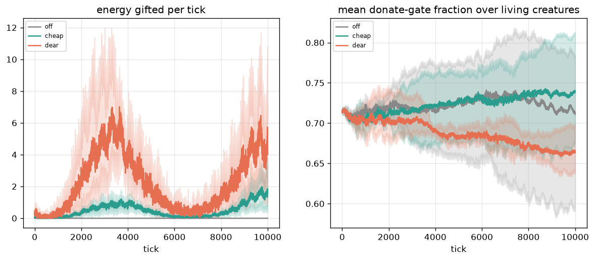
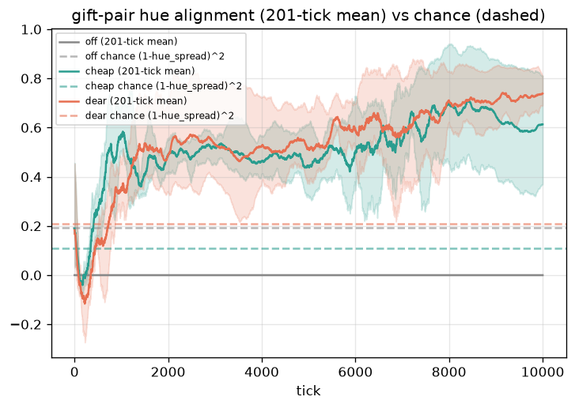
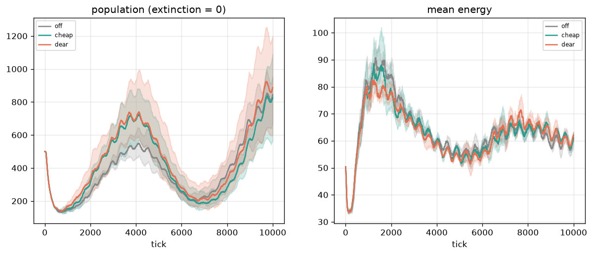

# Stage 16 — donation: does a gift channel survive selection?

## Question

Stage 16 added a physical gift: the donate gate (brain output 4) sends
`donate_rate * gate` energy to the **nearest living neighbour** inside
`donate_range` every tick. The recipient is pure physics (the mate
search's nearest-neighbour rule, so kin — born in place, clustered
9–23× chance since stage 15 — is what "nearest" happens to mean).
Nothing in the tick rewards giving (principle 1): if gifts persist it
must be because they pay for themselves in currencies the sim already
has. Where does the gate sit after 10k ticks of paying for every leak?

## Hypothesis (stated a priori, before any run on this code)

> **Hard gate:** all 9 runs (3 variants × seeds 42/7/13) complete 10k
> ticks with `min alive > 0`.
> **H1 (selection against the leak):** `donate_mean` falls from the
> first 20% to the last 20% of the run in the paying variants — the
> sigmoid's floor costs energy with no immediate return.
> **H2 (gifts follow kin):** `donate_align` (circular hue similarity of
> gift pairs, the stage-15 metric) sits above chance
> `(1 − hue_spread)²` — gifts preferentially reach colour-mates, which
> are the kin clusters.
> **Null is publishable:** a channel wired but unused (`donate_mean`
> pinned at the sigmoid floor) would be the stage-13 signal result again.

## Method

`configs/proto_culture.toml` (stage-12.5 "reach" predation, emit cost
**0.05** since stage 14's price sweep), canonical seeds 42/7/13, stats
every tick. Pilot first (800 ticks × 3 × 3, ~17 s) to sanity-check the
price bracket; then the pre-registered gate (10k × 3 × 3).

| variant | `donate_rate` | tax at gate 0.7 (metabolism = 0.08) |
|---|---|---|
| `off` | 0 (control) | 0 |
| `cheap` | 0.02 | ~18% |
| `dear` | 0.10 | ~88% |





## Results (gate, 10k ticks)

**Hard gate: PASS** — every run alive at 10k (min alive 121–137).

| variant | final pop (min/mean) | `donate_mean` first → last 20% | gifted total (3 runs) | align | chance |
|---|---|---|---|---|---|
| `off` | 677 / 845 | 0.713 → 0.721 | 0 | 0 | 0.194 |
| `cheap` | 569 / 827 | 0.708 → **0.737** ↑ | 4 738 | **0.511** | 0.108 |
| `dear` | 602 / 887 | 0.706 → **0.666** ↓ | 22 041 | **0.540** | 0.208 |

- **H1: refuted for `cheap`, weakly confirmed for `dear`.** The cheap
  gate *rose* (+4%) — at ~18% of metabolism the leak is invisible to
  selection in 10k ticks. The dear gate fell only −6% (it would have to
  approach 0 to stop paying) — selection finds the leak but walks away
  slowly even at ~88% of metabolism.
- **H2: confirmed, with margin.** Gift pairs are 4.7× (`cheap`) and
  2.6× (`dear`) above the chance level of a random pair, from ~1k
  ticks on (the figure's 201-tick mean never touches the dashed chance
  lines after the clusters form). The reading: gifts land on the
  nearest creature, and the nearest creature is a relative.
- Context: population and mean energy are statistically
  indistinguishable from the control (bands overlap; `dear` even ends
  with the highest mean pop — n=3, no claim). Predation totals
  994 / 650 / 971 and barrier (last 20%) 0.092 / 0.032 / 0.071
  (`off` / `cheap` / `dear`) differ across variants, but with n=3 and
  different evolutionary trajectories these are read as noise unless a
  follow-up replicates them.
- `hue_spread` final 0.544 / 0.695 / 0.448: colour is still a diverse
  trait at 10k, so the alignment signal is not "everyone converged to
  one hue" — a random pair is not automatically similar.

## Limitations

- **H1 is trajectory-dependent.** 10k ticks is short for selection on a
  leak that costs ~0.01–0.07 energy/tick/creature; the `cheap` rise
  could be drift or a kin-structure side effect. A 50k run might turn
  the dear −6% into a real close-down — not measured here.
- **`donate_align` is diluted on purpose.** Ticks with no gift pair read
  0 on the observed side only (the chance level is never diluted), which
  biases *against* H2 — it still passed. Ticks with pairs: 29 170/30 000
  and 29 193/30 000 (`cheap`/`dear`), so the dilution is ~3%.
- **Chance is estimated from the same run** (`(1 − hue_spread)²` uses the
  run's own colour spread) — correct as a null, but couples the two
  curves; a spatial-shuffle null (stage 15's style) would be stricter.
- **The recipient is always the nearest neighbour.** "Gift a random
  neighbour" or "gift the hungriest" are different social graphs this
  experiment does not explore.
- Population-level differences (barrier, predation) are **not** claims —
  n=3 with divergent trajectories; they are reported so a follow-up can
  preregister against them.

## Reproduce

```bash
python experiments/proto_culture/run.py --phase pilot   # ~17 s
python experiments/proto_culture/run.py --phase gate    # minutes of CPU
```

Caches in `data/` (gitignored) resume an interrupted batch; `--force`
reruns. Figures and the summary table are rebuilt from the caches on any
re-run.
